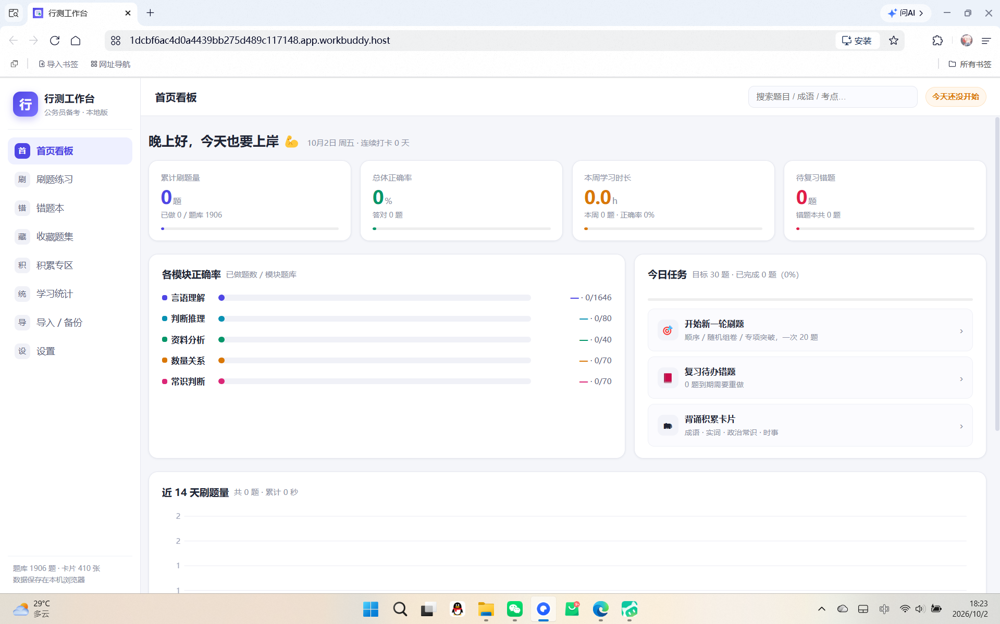
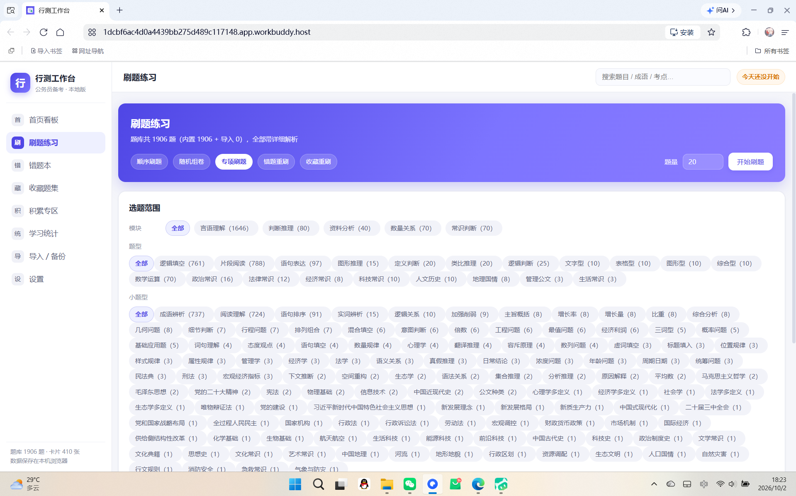
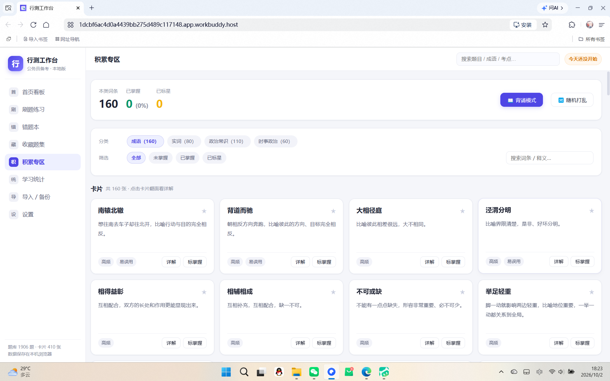

# 公务员行测学习工作台（xingce-workbench）

一个**零依赖、纯前端**的公务员行测备考工作台。五大模块题库、错题本、积累卡片、学习统计与首页看板，全部数据保存在你自己的浏览器里，不上传任何服务器。

> 本仓库自带少量**原创示例题**（仅用于演示，不含任何真题）。真实备考请通过「导入 / 备份」功能加入自己的题目，或交给 AI 助手整理。

---

## ✨ 功能特性

- **五大模块题库**：言语理解 / 判断推理 / 资料分析 / 数量关系 / 常识判断，内置详细解析。
- **多种刷题模式**：顺序刷题、随机组卷、专项刷题（可按模块/题型/栏目筛选）、错题重刷、收藏重刷。
- **错题本**：自动入库、打标签、笔记、二次作答与掌握度跟踪。
- **积累专区**：成语 / 实词 / 政治常识 / 时事政治卡片，支持翻转记忆与标星。
- **学习统计 & 首页看板**：累计刷题量、各模块正确率、本周时长、待复习错题数。
- **导入 / 备份**：支持 `.json / .csv / .txt / .md` 导入，提供三种模板；一键备份与合并恢复。
- **PWA**：可「添加到主屏幕」当作独立 App 使用（已配置 manifest）。
- **本地优先**：数据存于浏览器 `localStorage`，隐私可控。

---

## 📸 截图

| 首页看板 | 刷题练习 |
| --- | --- |
|  |  |

| 积累专区 | |
| --- | --- |
|  | 支持按模块 / 题型 / 小题型 / 栏目多级筛选，五大模块全部命中 |

---

## 🚀 快速开始

### 方式一：本地运行

```bash
# 需要 Node.js
node scripts/server.js
# 浏览器打开 http://localhost:8756
```

### 方式二：任意静态托管

直接把 `app/` 目录上传到 GitHub Pages / Nginx / 云沙箱等任意静态服务器即可，**无需构建步骤**。

### 方式三：作为 WorkBuddy Skill 使用

本仓库同时是一个 WorkBuddy Skill（`SKILL.md`）。把整个文件夹放进你的 Skill 目录后，即可在对话中让 AI 帮你「搭建 / 维护行测工作台」「整理题目进 app」「部署到手机或公网」。

---

## 📥 如何加入自己的题目

应用内「导入 / 备份」页提供三种模板（JSON / CSV / TXT），按模板填好直接上传即可；也支持宽松的自由文本粘贴（只要含题干、A/B/C/D 选项、答案即可，解析可选）。

**最简 JSON 示例：**

```json
[
  {
    "module": "言语理解",
    "type": "逻辑填空",
    "subtype": "成语辨析",
    "difficulty": 2,
    "stem": "依次填入画横线部分最恰当的一项是：______",
    "options": ["A．南辕北辙", "B．背道而驰", "C．大相径庭", "D．泾渭分明"],
    "answer": "A",
    "analysis": "【解析】“南辕北辙”比喻行动和目的相反……故正确答案为A。",
    "tags": ["成语辨析"]
  }
]
```

> 想让 AI 代劳？把题目文件（Word / PDF 转文字 / 网页复制文本）直接发给 AI 助手，告诉它「整理进行测 app」，它会按规范格式化并写入题库，刷新即可看到，且你的历史学习数据不会丢失。

### 🛠️ 高级：用脚本批量导入真题 PDF

仓库自带一批 Python / Node 脚本，可把整本**带文字层**的 PDF 题库结构化导入，无需逐题手填：

```bash
# 1) 抽取文字层（自动探测扫描版）
python scripts/extract_pdf.py 题库.pdf -o inbox/pdf_text

# 2) 按排版解析（欣说 / 郭熙自带专用解析器；其它格式用通用导入）
python scripts/parse_xinshuo.py --batch
python scripts/parse_guoxi.py --q inbox/pdf_text/guoxi_q.txt --a inbox/pdf_text/guoxi_a.txt --out inbox/parsed/guoxi.json

# 3) 把 inbox/ 下的 .json/.csv/.txt/.md 固化进题库（只追加不覆盖）
node scripts/ingest.js
```

> ⚠️ **扫描图片版 PDF 没有文字层**，`extract_pdf.py` 会直接警告；这类文件请先用 WPS / Adobe / 微信 的图片转文字，或本地 `tesseract + chi_sim` 做 OCR，再走上面的流程。
> 脚本细节见 [`SKILL.md`](SKILL.md) 的「PDF / 题库导入管线」章节与 [`references/schema.md`](references/schema.md)。

---

## 🗂️ 数据规范

题目与卡片为纯 JS 文件，完整字段、枚举、id 命名、文件命名与质量红线见 [`references/schema.md`](references/schema.md)。

模块固定枚举：`言语理解 / 判断推理 / 资料分析 / 数量关系 / 常识判断`。

---

## ✅ 自测

```bash
npm i jsdom          # 仅首次
node scripts/server.js &   # 启动服务
node scripts/smoke-test.js  # 模拟一次完整刷题流程，捕获运行时错误
```

---

## 📜 版权与免责

- 仓库内置示例题均为**原创或通用常识**，不含任何受版权保护的真题原文；真题请在使用时自行做“真题改编/模拟精编”处理，遵守相关版权规定。
- 本工具仅用于个人学习辅助，题目答案与解析以官方为准。

## 📄 License

[MIT](LICENSE)
